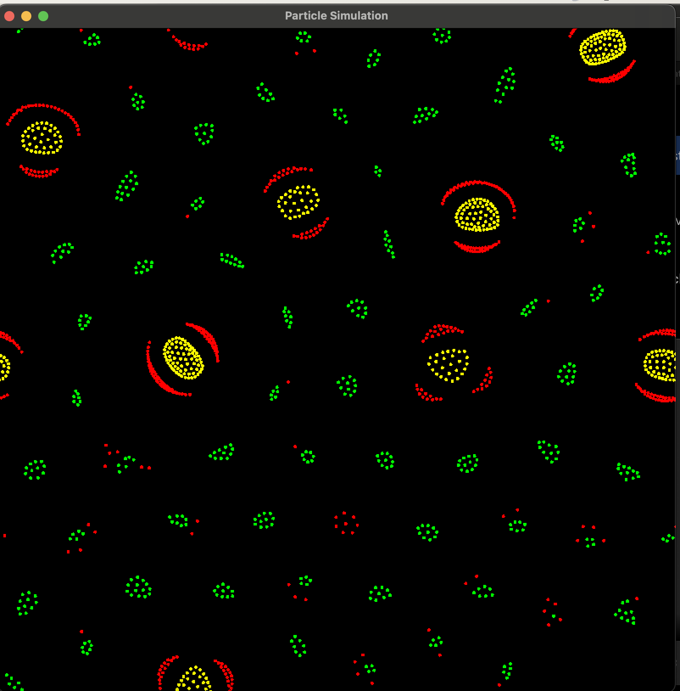
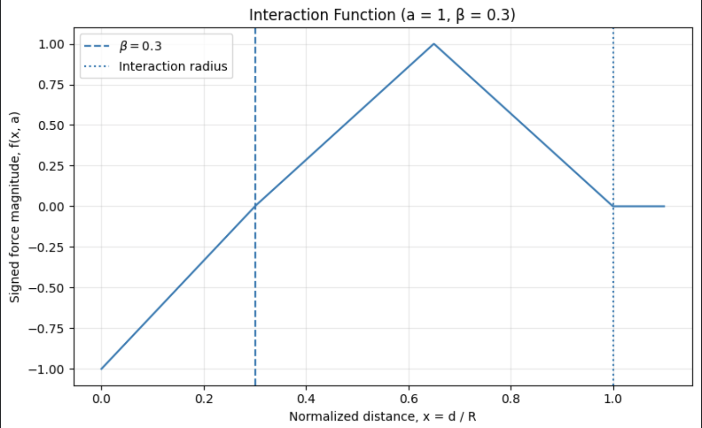
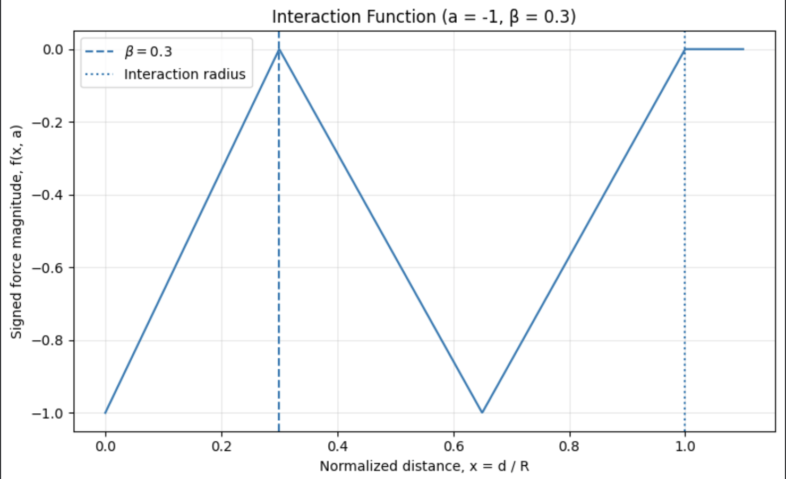

# Particle Life Simulator

<p align="center">

</p>

## Overview

<!-- Briefly describe the project, its purpose, and the behavior it simulates. -->
This project aims to demonstrate how interactions between simple particles can lead to complex phenomena.

## Features

- Simulate up to 1000 particles simultaeously. <!-- Feature 1 -->
- Simulate up to three different particle types at once. <!-- Feature 2 -->
- Generate a random simulation configuration for each new run. <!-- Feature 3 -->

## Physical Model

<!-- Explain the interaction rules, force function, and relevant parameters. -->
The physical model operates in a 2D world; therefore, all vector-valued physical quantities are represented by 2D vectors. The system also defines an interaction radius $R$. Two particles interact only when the distance between them is less than $R$. Beyond this radius, the interaction force is zero.

### Particle definition

Each particle $i$ is as a point having the following characteristics :
- A position, represented by a vector $\vec{r}_{i}(t)$.
- A velocity, represented by a vector $\vec{v}_{i}(t)$.
- An interaction with other particles, resulting in a force represented by $\vec{F}_{ij}(t)$, where $i$ denotes the particle experiencing the force and $j$ the particle exerting it.

### Interaction Force

#### Interaction rule matrix

To model interactions between particle types, we define an interaction matrix $A \in [-1,1]^{N \times N}$, where $N$ is the number of particle types.

The coefficient $a_{ij}$ represents the interaction rule governing the force exerted by a particle of type $j$ on a particle of type $i$. A value of $-1$ corresponds to maximum repulsion, while a value of $1$ corresponds to maximum attraction.

Formally :

$$
A = (a_{ij})_{1 \leq i,j \leq N},
\qquad a_{ij} \in [-1,1].
$$

For example, if $N = 3$, the interaction matrix is a $3 \times 3$ matrix:

$$
A =
\begin{pmatrix}
a_{11} & a_{12} & a_{13} \\
a_{21} & a_{22} & a_{23} \\
a_{31} & a_{32} & a_{33}
\end{pmatrix}
$$

#### Force function

To model the interaction force between two particles $i$ and $j$, we define the following piecewise function:


```math
f(x,a) =
\begin{cases}
\dfrac{x}{\beta} - 1, & x < \beta, \\
a\left(1 - \dfrac{|2x - 1 - \beta|}{1 - \beta}\right), & \beta \leq x < 1, \\
0, & x \geq 1,
\end{cases}
```

where:

- $x = \frac{d_{ij}}{R}$
- $d_{ij}$ is the distance between the particles $i$ and $j$. 
- $R$ is the interaction radius between the particles.
- $a = a_{ij}$ is the interaction coefficient from the interaction matrix $A$.
- $\beta$ defines the boundary between the coefficient-dependent interaction and the the short-range repulsion between particles $i$ and $j$.

The plots below show the interaction function for $\beta = 0.3$, with $a = 1$ (left) and $a = -1$ (right).
<p align="center">
  
  
</p>

As you can see:

- When $x < \beta$, $f(x, a) < 0$. Therefore, regardless of the value of $a$, the interaction is repulsive.
- When $\beta \leq x < 1$, the interaction is attractive if $a > 0$ and repulsive if $a < 0$.
- When $x \geq 1$, $f(x, a) = 0$, meaning that there is no interaction between the particles. This is expected because $\frac{d_{ij}}{R} \geq 1 \implies d_{ij} \geq R$, which means that the particles are outside the interaction radius $R$.

**Note:** $f(x, 0) = 0 \quad \text{for } x \geq \beta$ $\quad \text{and} \quad f(\beta, a) = 0 $.

Having established these definitions, the forces exerted between a pair of particles $(i,j)$ can be computed as follows:
- $\vec{F_{ij}(t)} = S * f(x, a_{ij}) * \vec{u_{ij}}$
- $\vec{F_{ji}(t)} = - S * f(x, a_{ji}) * \vec{u_{ij}} = S * f(x, a_{ji}) * \vec{u_{ji}}$

where (S) is a scaling factor, and $\vec{u}_{ij}$ and $\vec{u}_{ji}$ are unit vectors pointing from particle (i) to particle (j) and from particle (j) to particle (i), respectively.


<!-- Add the force equation and define its variables. -->

### Particle Motion

To describe particle motion, we use the classical equations of motion. As defined above, each particle $i$ is characterized by its position $\vec{r}_i(k)$, velocity $\vec{v}_i(k)$, and mass $m = 1$. The force $\vec{F}_{ij}(k)$ represents the interaction force exerted by particle $j$ on particle $i$. The resultant force acting on particle $i$ is obtained by summing the interaction forces from all other particles.

The equations of motion are discretized as follows:

- $`\vec{v}_{i}(k) = \vec{v}_{i}(k-1) + \left(\sum_{j \neq i}\vec{F}_{ij}(k)\right)\Delta t`$
- $`\vec{r}_{i}(k) = \vec{r}_{i}(k-1) + \vec{v}_{i}(k)\Delta t`$

<!-- Briefly explain velocity updates, friction, and boundary conditions. -->


## Architecture

<!-- Describe the main components and their responsibilities. -->

- `Vec2`:
- `Particle`:
- `ParticleSystem`:
- Renderer:

## Build and Run

### Requirements

- C++20
- CMake
- SFML <!-- Specify version -->

### Build

```bash
cmake -S . -B build
cmake --build build
```

### Run

```bash
./build/<executable-name>
```

## Results

<!-- Add screenshots and briefly describe interesting emergent behaviors. -->

## Limitations and Future Improvements

<!-- Mention current limitations and the improvements you plan to make. -->

## License

<!-- Specify the project license. -->